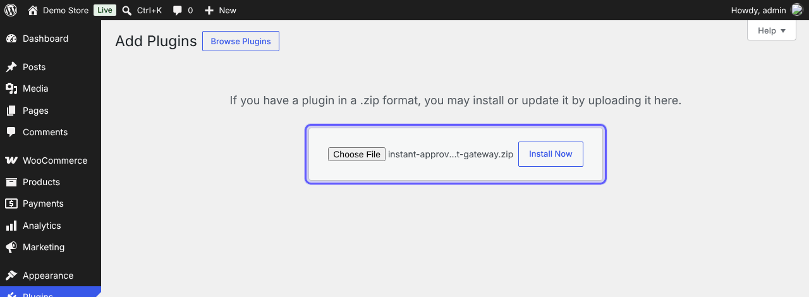
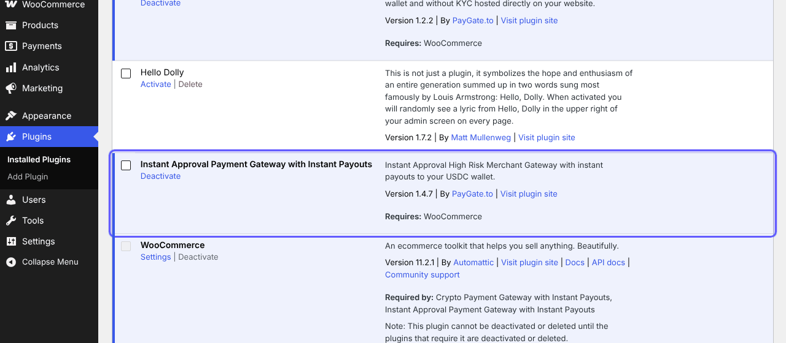
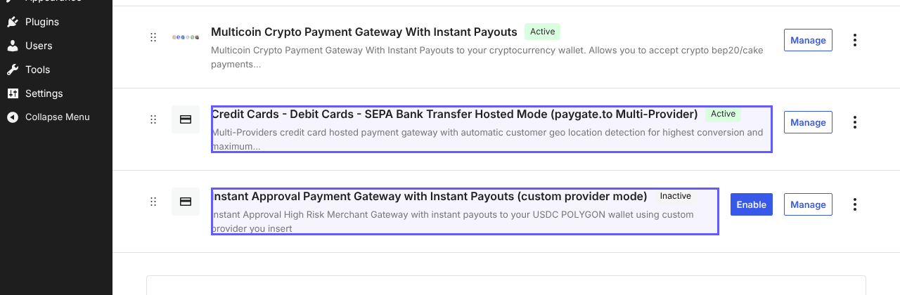
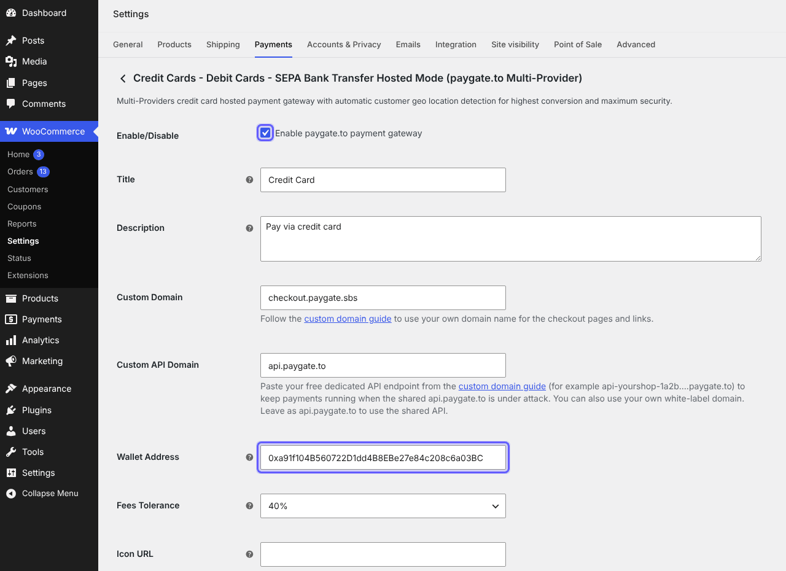
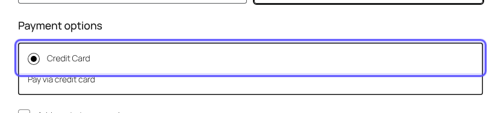
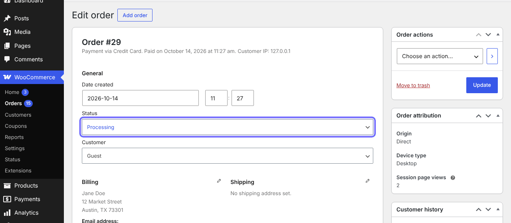

# WooCommerce-Instant-Payment-Gateway
Instant WooCommerce payment gateway to accept credit or debit cards or Google Pay or Apple Pay. Instant payouts to USDC wallet.

> 🪙 **Want crypto too?** Our free [WooCommerce crypto module](https://paygate.to/crypto-payment-gateway-no-kyc-instant-payouts/woocommerce/) is the only crypto payment gateway with instant payouts for Solana, Monero, Zcash and Bitcoin.

## Features

- Accept **Visa, Mastercard, Apple Pay, Google Pay**, SEPA and local bank transfers.
- **Instant approval**: no sign up, no merchant account, no API keys and no KYC for you.
- **Instant payouts** to your own USDC (Polygon) wallet with every payment.
- **Zero chargebacks**: all payments are final.
- Multi-provider hosted payment page that picks the best provider for each customer's country, or one provider of your choice.
- Payment confirmations signed by PayGate.to and verified by the module: orders are updated automatically.
- Works with your own checkout domain and a free dedicated API endpoint ([custom domain guide](https://paygate.to/white-label-api-custom-domain-guide/)).
- Fees: **1% + provider fees**.

📘 **Step-by-step guide with screenshots:** [https://paygate.to/instant-payment-gateway/woocommerce/](https://paygate.to/instant-payment-gateway/woocommerce/)

## Requirements

- WordPress 5.8+ and **WooCommerce 5.8+**, PHP 7.2+ with OpenSSL
- A public website (payment confirmations cannot reach localhost)
- A USDC (Polygon) wallet address

## Installation

1. **Get your payout wallet.** Card payments are paid out to a **USDC wallet on Polygon** (an address that starts with `0x`). Payouts may arrive as USDC, USDT (Polygon or BEP-20), ETH or POL, and the same address receives all of them. Use a **self-custodial wallet** you control (Trust Wallet, MetaMask, Rabby, a hardware wallet). **Never use an exchange deposit address**, and never paste the USDC token contract address.
2. **Install the plugin.** In WordPress open **Plugins › Add Plugin** ("Add New Plugin" in some versions), search for **Instant Approval Payment Gateway with Instant Payouts** and click **Install Now**, or download it from [WordPress.org](https://wordpress.org/plugins/instant-approval-payment-gateway/) / this repository and use **Upload Plugin**.

   

3. **Activate** the plugin (WooCommerce must be active).

   

4. Open **WooCommerce › Settings › Payments**. Two methods are added: **Credit Cards - Debit Cards - SEPA Bank Transfer Hosted Mode (paygate.to Multi-Provider)** (recommended) and **Instant Approval Payment Gateway with Instant Payouts (custom provider mode)**. Click **Manage**.

   

5. Tick **Enable**, paste your Polygon address into **Wallet Address** and click **Save changes**.

   

6. **Test**: customers choose the card method at checkout and pay on the secure payment page.

   

7. When the payment is confirmed the order moves from **Pending payment** to **Processing** automatically, with the payout TXID in the order notes.

   

## Settings

| Setting | Description | Default |
|---|---|---|
| Wallet Address (required) | Your USDC (Polygon) payout address. Saving fails with "Invalid Wallet Address" if it is not a `0x` address. | – |
| Title / Description | What customers see at checkout. | Credit Card / Pay via credit card |
| Custom Domain | Domain of the hosted payment page. | checkout.paygate.sbs |
| Custom API Domain | Your free dedicated API endpoint or white-label domain. | api.paygate.to |
| Fees Tolerance | How far below the total a payment may be before the order is marked Failed. | 40% |
| Icon URL | Icon shown at checkout. | empty |
| Custom Logo URL, Background / Theme / Button Color | Branding of the hosted page (hosted mode). | empty |
| Custom Provider Tag, Minimum Amount | Provider and USD minimum (custom provider mode). [Provider list](https://api.paygate.to/control/provider-status/). | moonpay, 15 |

## Order statuses

- **Pending payment**: the customer was sent to the payment page.
- **Processing** (or Completed for virtual/downloadable orders): payment confirmed.
- **Failed**: less than your Fees Tolerance was received.

## Troubleshooting

- **"There are no payment methods available"**: check the method is enabled and saved, then follow [this guide](https://paygate.to/fix-woocommerce-there-are-no-payment-methods-available-error/).
- **Order stays Pending after payment**: your site must be public and nothing (security plugin, firewall, CDN, cache) may block `/wp-json/`. See [WooCommerce troubleshooting](https://paygate.to/woocommerce-payment-gateway-troubleshooting/).
- **Minimum amounts** vary by provider (about $1 to $30): [see the minimums](https://paygate.to/instant-payment-gateway/#minimumorder).

Full product page: [https://paygate.to/instant-payment-gateway/](https://paygate.to/instant-payment-gateway/) · Support: [Telegram](https://t.me/PayGate_to)
